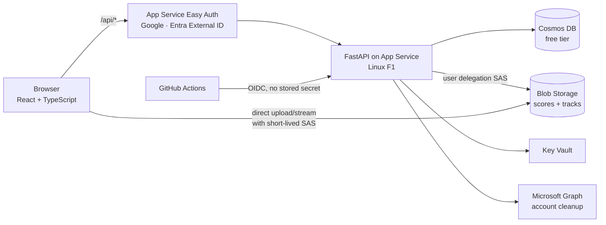

# Rehearsal Hub

A members-only web app for the **University of Birmingham Barbershop Singing Society** (30–80 members). Members get their scores and per-part learning tracks, mark songs as learned, see the rehearsal schedule and RSVP. The committee manages songs, rehearsals, announcements, groups and members from one admin page.

**Live:** https://bss-rehearsal-hub.azurewebsites.net (members only, so signed out you'll see the sign-in page and the [privacy notice](https://bss-rehearsal-hub.azurewebsites.net/privacy))

> This is a public copy of a private repository. The code and commit history are real. Deployment parameters, internal runbooks and the project's working notes are left out (see [What's not here](#whats-not-here)).

## Features

- **Songs and scores.** Score PDFs and MP3 learning tracks for tenor, lead, baritone and bass, plus full mixes. The player works on phones (including lock-screen controls) and renews its expiring links without stopping.
- **Learned tracker.** Each member marks every song not started / learning / learned / ready. Admins see a song × member grid with per-part counts.
- **Rehearsal schedule.** Upcoming rehearsals with the songs on the plan, and RSVPs. Admins see who's coming and which parts are covered for each song.
- **Groups and announcements.** Rehearsals and posts can be limited to groups (e.g. auditioned chorus, committee). Admin rights come from group membership instead of being stored as a flag.
- **Admin tools.** Bulk score upload, member invites by email, song tags and filters, and a feedback inbox.
- **Data rights (UK GDPR).** Members can export all their data or delete their account. Deletion also removes their sign-in account from the identity provider.
- **Installable** as a PWA on phones.

## Architecture



| Layer | Choice |
|---|---|
| Front end | Vite, React, TypeScript (`app/`) |
| Back end | Python 3.11, FastAPI, gunicorn (`api/`). Serves the API and the built front end from one origin |
| Data | Azure Cosmos DB for NoSQL (free tier), Azure Blob Storage |
| Auth | App Service built-in auth with Google, plus email and password through a Microsoft Entra External ID tenant |
| Infra as code | Bicep (`infra/main.bicep`) |
| CI/CD | GitHub Actions: type-check and build, test, then deploy over OIDC (`.github/workflows/deploy.yml`) |
| Monitoring | Application Insights (server side only, IPs masked) |

## Design decisions worth a look

- **No secrets in the code or the pipeline.** GitHub deploys by OIDC as a user-assigned identity scoped to one web app and the `production` environment. The app reaches Storage, Cosmos DB and Microsoft Graph through managed identities. The two OAuth client secrets are Key Vault references. Publish profiles and FTP/SCM basic auth are switched off.
- **Short-lived, single-file storage links.** Members never get storage keys. The API hands out per-file user delegation SAS links (15-minute read-only links, 5-minute write links for admins only). After an upload it checks the size and magic bytes before recording the file, and refuses to serve a file whose ETag has changed since then.
- **Roles worked out on every request.** member < admin < owner. Admin comes from belonging to an admin-access group and is recomputed on every request, so a stale stored role grants nothing. Every endpoint goes through one `require_role` dependency.
- **Careful identity trust.** The `X-MS-CLIENT-PRINCIPAL` header is only trusted when Easy Auth is actually on. Only listed providers are accepted, Google emails must be verified, and Entra tokens must come from the society's own tenant. Invites match on verified email, and a second sign-in method is linked to the same member only through that verified email.
- **Concurrency-safe writes.** RSVPs and edits use Cosmos DB partial updates instead of read-modify-write, so simultaneous changes can't overwrite each other.
- **Built for the free tier.** The F1 plan allows 60 CPU-minutes a day and has no Always On, so CI installs dependencies and boots the exact package before deploying, and nothing builds on the server. Budget alerts at $5 and $20 are in the Bicep.
- **Moving tenants.** The app started on an Azure for Students subscription and was moved to the society's own tenant. Everything was rebuilt from Bicep and the data copied with `infra/migrate_tenant.py`.

## Tests and CI

The API has around 200 pytest tests (`api/test_*.py`). They cover role enforcement, identity and account linking, CSRF, security headers, and every feature area. Every push type-checks and builds the front end and runs the tests. Merges to `main` in the private repo deploy automatically (this copy only builds and tests).

## How it was built

I planned and built this myself, with Claude Code as my pair programmer: I made the design decisions, reviewed every change and tested it on real devices. The commit trailers show where the AI helped. Work went in milestones: foundations → sign-in and members → songs and tracks → learned tracker → rehearsal schedule → pilot with real members.

## Local development

Needs Node 20+ and Python 3.11.

```bash
# API (terminal 1): in-memory store and a fake signed-in user
cd api
python3.11 -m venv .venv
.venv/bin/pip install -r requirements-dev.txt
ALLOW_DEV_AUTH=1 DEV_USER_EMAIL=you@example.com .venv/bin/uvicorn main:app --reload --port 8000

# Front end (terminal 2): http://localhost:5173, /api is proxied to :8000
cd app
npm install
npm run dev
```

Run the tests with `cd api && .venv/bin/pytest`.

## What's not here

To protect a live service that holds members' personal data, this copy leaves out:
- the real deployment parameters (start from `infra/main.example.bicepparam`)
- the tenant-migration runbook and the project's internal working notes
- security audit reports

Subscription, tenant and resource identifiers have been replaced with placeholders throughout the history.
